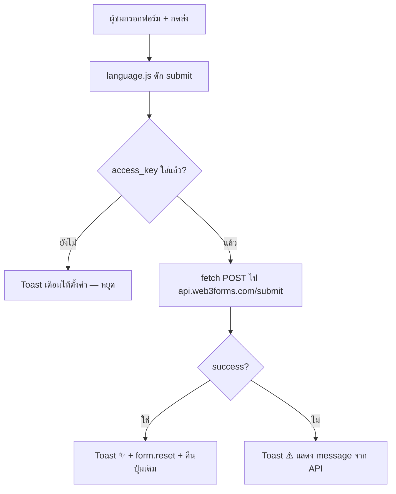

# DESIGN.md - สถาปัตยกรรมเว็บ Portfolio (Superr Notebook)

เอกสารออกแบบและโครงสร้างระบบของเว็บ Portfolio — อ่านก่อนแตะโครงสร้าง HTML/CSS/JS ทุกครั้ง
> กฎร่วมทุก Agent: [AGENT.md](AGENT.md) · มาตรฐานโค้ด/ดีไซน์: [STYLE.md](STYLE.md) · เครื่องมือ: [GEMINI.md](GEMINI.md) / [OPENCODE.md](OPENCODE.md) · Skills: [SKILL.md](SKILL.md)

---

## 1. ภาพรวมระบบ

- **ชนิด**: Static Single-Page Website (ไม่มี backend ของตัวเอง)
- **ธีม**: "Superr Notebook" — สมุดโน้ต/สติกเกอร์/โพลารอยด์ โทนอบอุ่น (ดู token ทั้งหมดใน [STYLE.md](STYLE.md))
- **ผู้ใช้ปลายทาง**: นายจ้าง/ฝ่าย HR ที่เข้าดูผลงานของ Pimphakan Klinhom (ฝึกงานสาย UI/UX + Frontend)

## 2. โครงสร้างไฟล์

| ไฟล์ | หน้าที่ |
| :--- | :--- |
| `index.html` | หน้าเดียวทั้งเว็บ — ทุก section อยู่ในนี้ |
| `css/style.css` | ดีไซน์หลัก: Design Tokens (`:root`) + คอมโพเนนต์ + Responsive |
| `css/animations.css` | แอนิเมชัน: สติกเกอร์ลอย, คอนเฟตติคลิก, page loader |
| `js/main.js` | อินเทอร์แอกชัน: loader, AOS, ScrollSpy, เมนูมือถือ, คลิกสปาร์เคิล, `showToast` |
| `js/language.js` | ระบบ 2 ภาษา TH/EN + ตัวส่งฟอร์ม (Web3Forms AJAX) |
| `assets/` | ไฟล์แนบอื่น ๆ (ปัจจุบัน `images/` ว่าง) |

## 3. ลำดับชั้นหน้าเว็บ (Sections)

```
navbar (sticky + แฮมเบอร์เกอร์มือถือ .menu-open)
├── #hero      — ชื่อ, tagline, ปุ่ม CV, สมุดโน้ต + สติกเกอร์ลอย
├── #about     — polaroid + แนะนำตัว + fact-tags
├── #skills    — การ์ดทักษะ (UI/UX + Frontend)
├── #timeline  — ไทม์ไลน์เส้นทางการเรียนรู้
├── #projects  — การ์ดผลงาน 2 ชิ้น (hardcode ใน HTML — ไม่มีระบบดึงข้อมูลภายนอก)
├── #contact   — ฟอร์มส่งข้อความ (Web3Forms) + ปุ่ม GitHub
└── footer     — แถบปิดท้าย
```

## 4. บริการภายนอกที่ใช้

| บริการ | ใช้ทำอะไร | จุดเชื่อม |
| :--- | :--- | :--- |
| Web3Forms API | ส่งข้อความจากฟอร์มเข้า Gmail | `index.html` (hidden `access_key`) + `js/language.js` (fetch AJAX) |
| Google Fonts | Fraunces / Kanit / Caveat | `<head>` ของ `index.html` |
| AOS 2.3.4 (unpkg) | แอนิเมชันตอน scroll | `data-aos` attributes |
| Iconify | ไอคอนทุกจุด | `<iconify-icon>` |

> ⚠️ Web3Forms ฟรีแพนรับเฉพาะการส่งจากเบราว์เซอร์ — อย่ายิงจาก curl/เซิร์ฟเวอร์ (จะโดนปฏิเสธ)

## 5. ระบบภาษา (TH/EN)

- Dictionary แปลอยู่ใน `js/language.js` (object `translations`) — ผูกกับ element ผ่าน `id` เช่น `#hero-name`, `#about-desc`
- ปุ่มสลับ: `.lang-btn[data-lang="th|en"]` → `setLanguage()` → อัปเดตทุก `id` + ปุ่ม active
- ข้อความใหม่ทุกอันต้องมี **ทั้ง TH และ EN** และใส่ `id` ให้ครบ (กฎใน [AGENT.md §2](AGENT.md#2-core-principles-หลักการสำคัญ))

## 6. Flow การทำงานของฟอร์ม



## 7. ฟีเจอร์เสริมที่มีแล้ว

| ฟีเจอร์ | ไฟล์ที่เกี่ยว | หมายเหตุ |
| :--- | :--- | :--- |
| 🌙 Dark Mode | `style.css` (html.dark), `main.js` initTheme | จำค่าใน localStorage `superr-theme`, ตาม prefers-color-scheme ครั้งแรก |
| ✨ Typing caption | `main.js` initTypingCaption | พิมพ์ `#hero-script-note` ทีละตัว, เคารพ prefers-reduced-motion |
| 🔝 ปุ่มเลื่อนขึ้นบน | `main.js` initFloatingButtons | โผล่เมื่อ scroll > 600px |
| 🔗 ปุ่มคัดลอกลิงก์เว็บ | `main.js` initFloatingButtons | มุมซ้ายล่าง, clipboard API |
| 🖼️ กรอบพรีวิวการ์ดผลงาน | `index.html` (.project-preview) | ใส่รูปจริง: แทนเนื้อในด้วย `` |

## 8. แผนอนาคต (ยังไม่ทำ)

- 📊 Analytics (ต้องสมัคร Google/Vercel Analytics ก่อน)
- 📁 ย้ายการ์ดผลงานเป็นข้อมูล JSON เมื่อมีผลงาน 3+ ชิ้น
- 🔤 ภาษาที่สาม (จีน/ญี่ปุ่น) ถ้าเป้าหมายเป็นบริษัทต่างชาติ

## 9. ข้อจำกัดและงานค้าง

- ฟีเจอร์ดาวน์โหลด CV ถูกตัดออกตามคำสั่งเจ้าของเว็บ (กลับมาได้โดยเพิ่มปุ่ม + ไฟล์ใน `assets/`)
- ไม่มีระบบ CMS/ฐานข้อมูล — แก้เนื้อหาการ์ดผลงานที่ `index.html` ตรง ๆ
