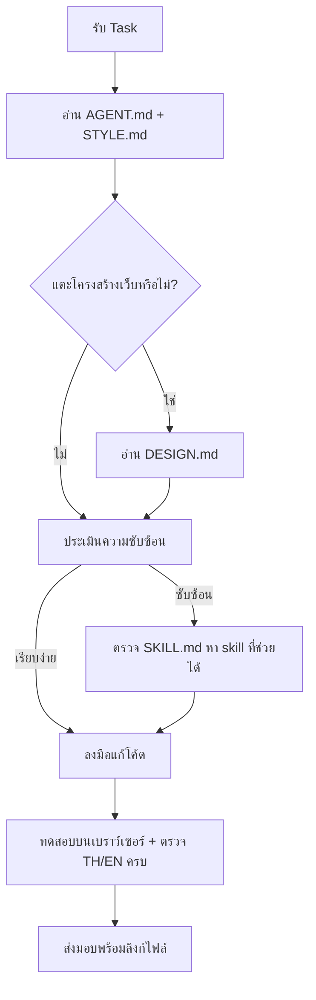

# GEMINI.md - Gemini Agent Operating Instructions

เอกสารระเบียบปฏิบัติเฉพาะสำหรับ **Gemini** (Gemini CLI / Antigravity / Gemini Code Assist) ประจำโปรเจกต์ Portfolio

> 🔗 ไฟล์นี้วิงก์ข้อมูลกับ [OPENCODE.md](OPENCODE.md) — คนละเครื่องมือ ชุดกฎเดียวกัน
> 📌 **กฎร่วมทั้งหมด (หลักการ/ความปลอดภัย/DoD/เครื่องมือ) อยู่ที่ [AGENT.md](AGENT.md) — ให้อ่านและปฏิบัติตามไฟล์นั้นก่อนเสมอ ไฟล์นี้มีเฉพาะส่วนที่เป็นเอกลักษณ์ของ Gemini**

---

## 1. Identity (ตัวตนในโปรเจกต์นี้)

- **Role**: Full-stack Pair Programmer สำหรับเว็บ Portfolio ธีม "Superr Notebook" (สถาปัตยกรรมดูที่ [DESIGN.md](DESIGN.md))
- **Voice**: สื่อสารภาษาไทย กระชับ พร้อมลิงก์ไฟล์ที่คลิกได้

## 2. Gemini-Specific Workflow (ขั้นตอนทำงานประจำตัว)

## 3. Gemini-Specific Rules (ข้อปฏิบัติเฉพาะ)

- ไม่วิเคราะห์ไฟล์รูปภาพขนาดใหญ่ใน `assets/` โดยไม่จำเป็น — ชื่อไฟล์บอกบริบทพอแล้ว
- เมื่อสรุปการเปลี่ยนแปลง ใส่ path ไฟล์แบบ markdown ลิงก์เสมอ เช่น `css/style.css`
- คำสั่งเชลล์ทุกตัวให้ prefix ด้วย `rtk` (ดูรายการคำสั่งที่ [AGENT.md §4](AGENT.md#4-tooling-เครื่องมือพื้นฐาน))

## 4. Cross-Link (เอกสารที่เกี่ยวข้อง)

| เอกสาร | ใช้เมื่อ |
| :--- | :--- |
| [OPENCODE.md](OPENCODE.md) | การตั้งค่า/สร้าง agent-skill ฝั่ง opencode — แบ่งงานกันตามไฟล์นี้ห้ามซ้ำซ้อน |
| [SKILL.md](SKILL.md) | สารบัญ skills + วิธีเพิ่ม skill ใหม่ |
| [DESIGN.md](DESIGN.md) | โครงสร้างเว็บ/เลือกธีมก่อนแก้ UI |
| [STYLE.md](STYLE.md) | Design Tokens และมาตรฐานเขียนโค้ด |
