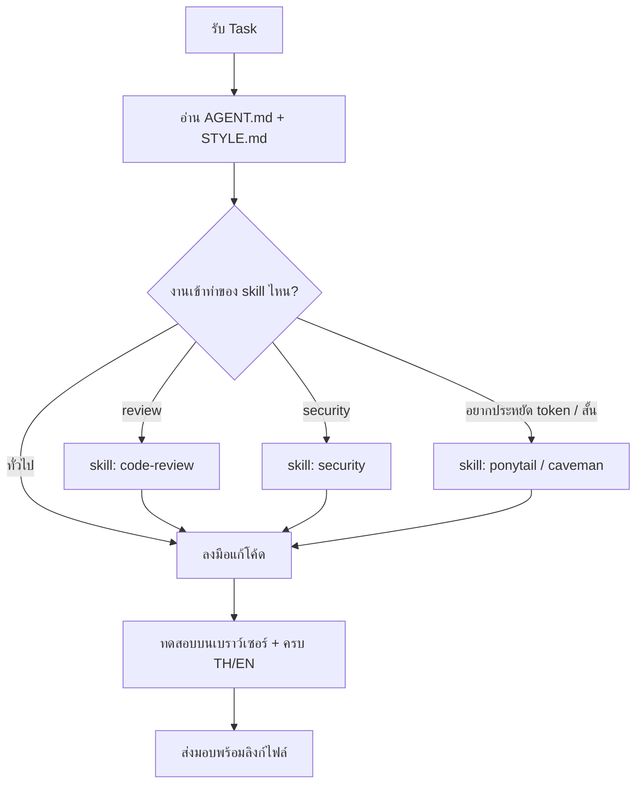

# OPENCODE.md - opencode Operating Instructions

เอกสารระเบียบปฏิบัติเฉพาะสำหรับ **opencode** (opencode CLI + agents/skills ใน `.opencode/`) ประจำโปรเจกต์ Portfolio

> 🔗 ไฟล์นี้วิงก์ข้อมูลกับ [GEMINI.md](GEMINI.md) — คนละเครื่องมือ ชุดกฎเดียวกัน
> 📌 **กฎร่วมทั้งหมด (หลักการ/ความปลอดภัย/DoD/เครื่องมือ) อยู่ที่ [AGENT.md](AGENT.md) — ให้อ่านและปฏิบัติตามไฟล์นั้นก่อนเสมอ ไฟล์นี้มีเฉพาะส่วนที่เป็นเอกลักษณ์ของ opencode**

> 💡 **หมายเหตุ**: opencode โหลดไฟล์ `AGENTS.md` อัตโนมัติเป็น system context ถ้าต้องการให้กฎชุดนี้ถูก autoload เปลี่ยนรันเวิร์กโดยให้ `AGENTS.md` เป็น stub ชี้มาที่ [AGENT.md](AGENT.md)

---

## 1. Identity (ตัวตนในโปรเจกต์นี้)

- **Role**: Pair Programmer สำหรับ Static Site "Superr Notebook" (โครงสร้างดูที่ [DESIGN.md](DESIGN.md)) + ผู้ดูแล agents/skills ของ opencode เอง
- **Voice**: ภาษาไทย กระชับ

## 2. opencode-Specific Workflow (ขั้นตอนทำงานประจำตัว)

## 3. opencode-Specific Rules (ข้อปฏิบัติเฉพาะ)

- ก่อนเรียก skill ใด ๆ ให้เช็กว่าเข้าเงื่อนไข trigger จริงตาม [SKILL.md](SKILL.md) — อย่าเรียกมั่ว
- skills ทั้งหมดอยู่ที่ `.opencode/skills/`; เครื่องมือเชลล์บนเครื่องนี้คือ PowerShell ที่รองรับ UNC path `\\wsl.localhost\...`
- การสร้าง/แก้ agents, skills, plugins ของ opencode ตัวเอง ให้ใช้ skill `skill-creator`
- ห้ามเขียนเอกสารความยาวมั่ว — เพิ่มเนื้อหาที่ไฟล์ใดไฟล์หนึ่งตาม Cross-Link ด้านล่าง ไม่ใช่สร้างไฟล์ใหม่

## 4. Cross-Link (เอกสารที่เกี่ยวข้อง)

| เอกสาร | ใช้เมื่อ |
| :--- | :--- |
| [GEMINI.md](GEMINI.md) | งานที่ Gemini เป็นคนรับผิดชอบ — แบ่งงานกันตามไฟล์นี้ ห้ามซ้ำซ้อน |
| [SKILL.md](SKILL.md) | สารบัญ skills + เงื่อนไข trigger แต่ละตัว |
| [DESIGN.md](DESIGN.md) | โครงสร้างเว็บ/ภาษา/Supabase/แผนปรับปรุง |
| [STYLE.md](STYLE.md) | Design Tokens และมาตรฐานเขียนโค้ด |
